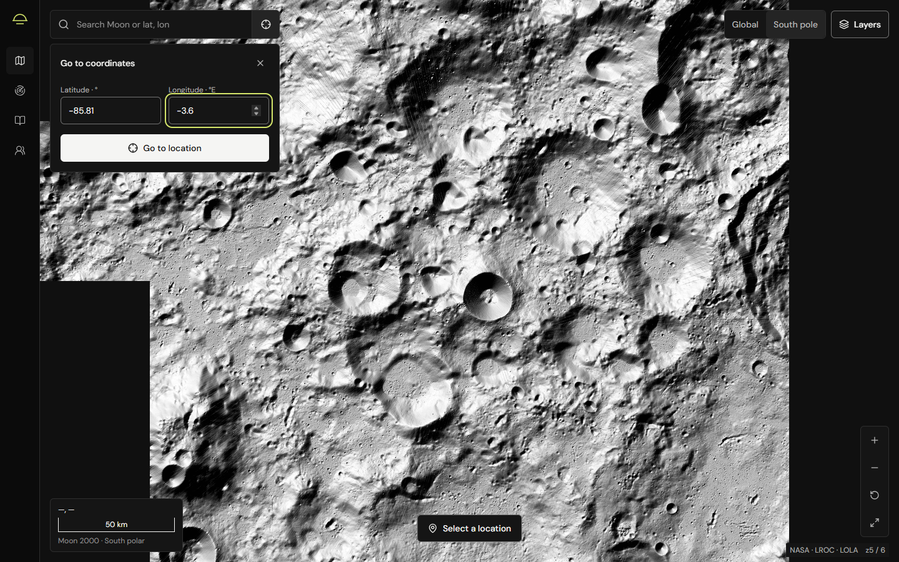
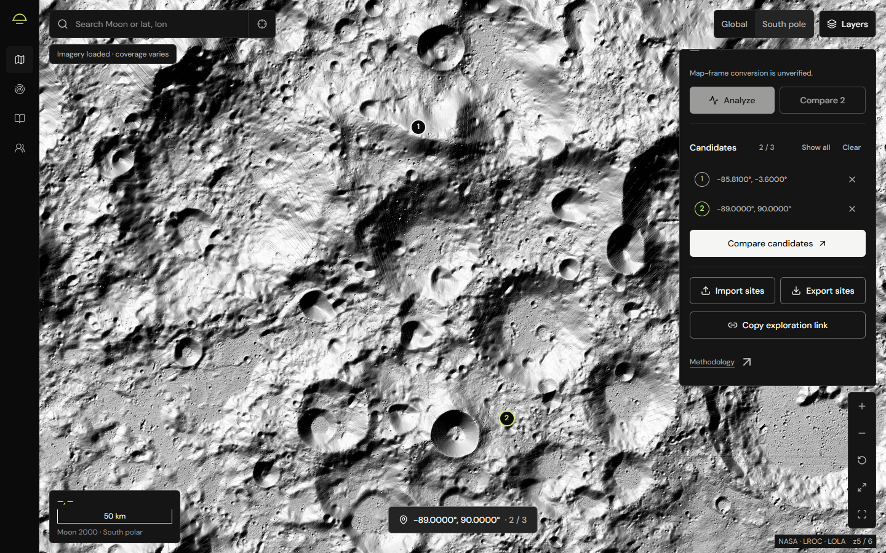
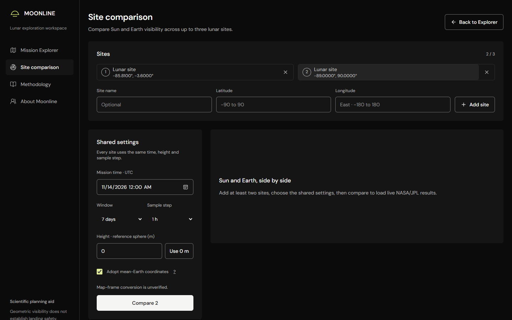
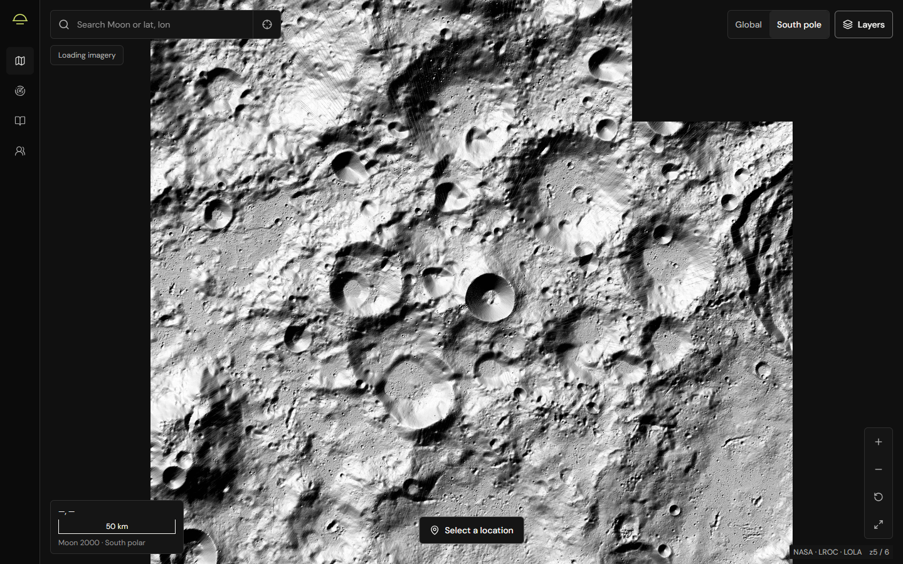
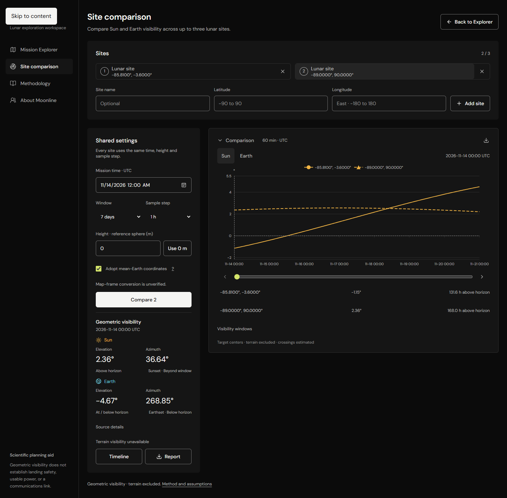
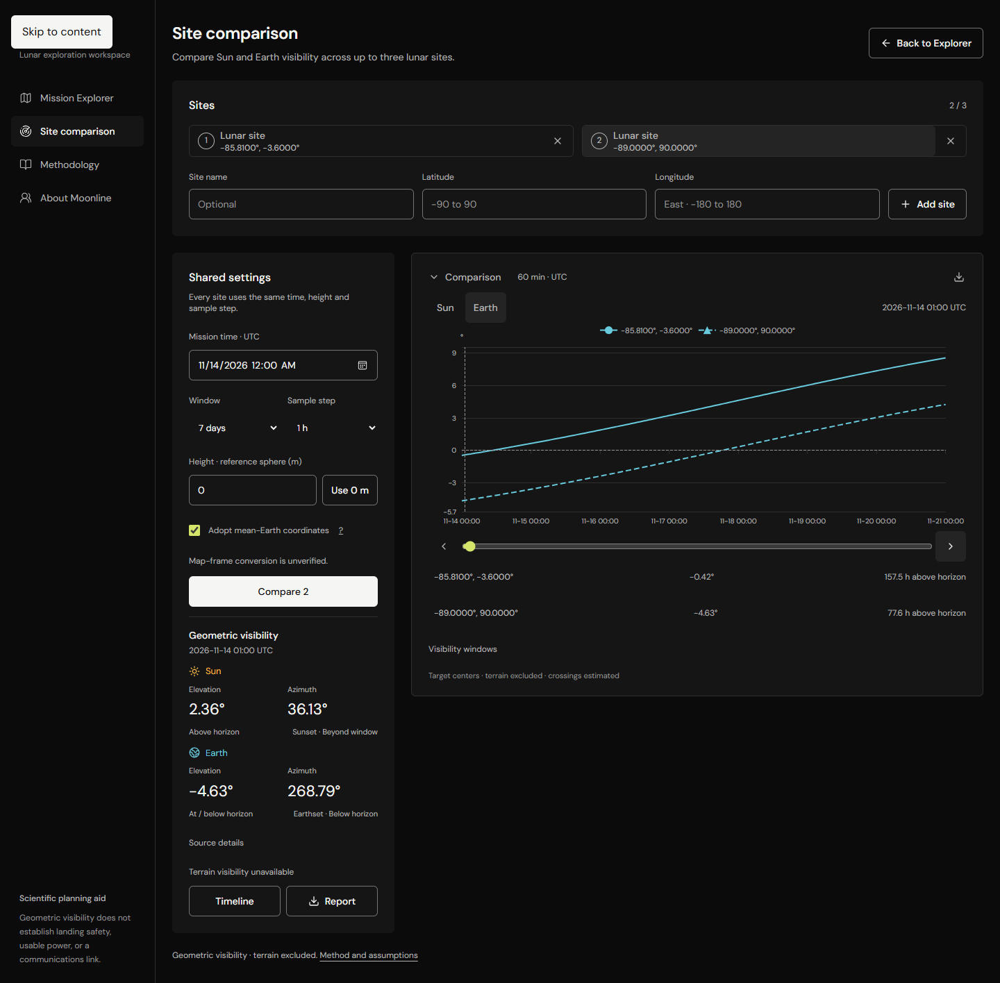
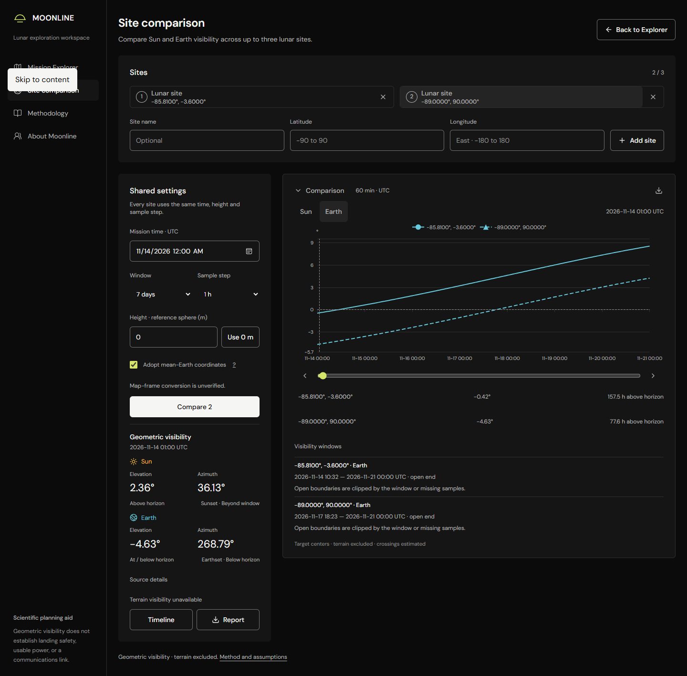
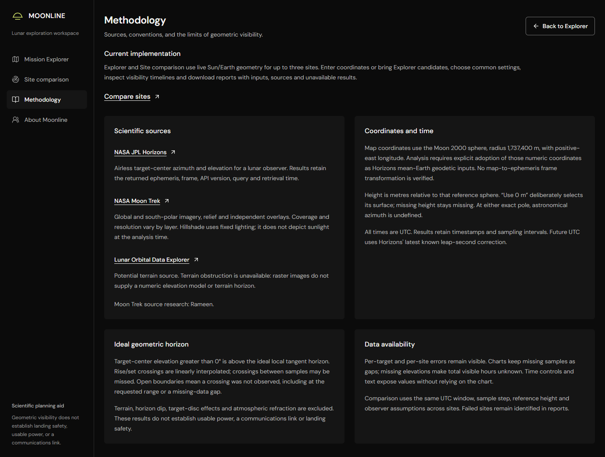
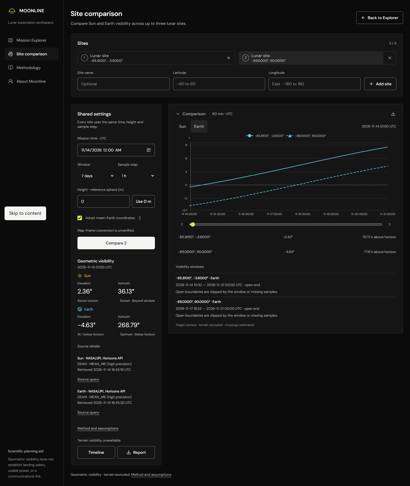
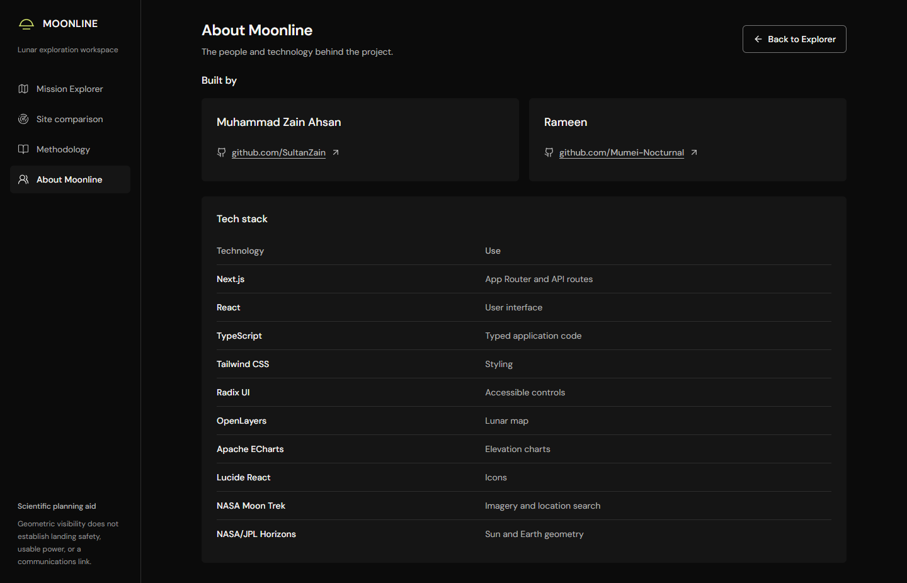

# Moonline video director’s guide

**Make the submission video 28 seconds.** NASA’s 2026 Project Submission Guide limits the Project Demo video to **30 seconds or less**. The longer walkthrough below is for practice. Use the short cut for the Project Demo field.

Open [the illustrated guide](director-guide.html) in your browser. Keep it on your phone or a second screen while recording. Read only the **SAY** text aloud; everything else is an instruction for you.

## 1. What story are we telling?

NASA’s **Lunar Landing Site Navigator** challenge asks for an intuitive way to compare lunar landing locations and dates. Near the south pole, changing a location or date changes the Sun’s and Earth’s position relative to the horizon. This affects potential solar power and direct-to-Earth communication opportunities. Existing tools make quick comparison difficult.

Moonline puts NASA Moon Trek maps, custom site selection, live NASA/JPL Horizons geometry, shared UTC settings, and comparison timelines in one workflow. Show the viewer a decision: **one site has more modeled Sun visibility, while another has more modeled Earth visibility.** There is no universal winning site.

Our current result is an **ideal geometric visibility estimate**. Terrain obstruction, a verified map-to-ephemeris coordinate conversion, usable power, communications reliability, and landing safety remain outside this result.

## 2. Before pressing Record

1. Leave the app server running. Open **http://localhost:3000/explorer**. If you use the deployed app, replace only the origin; the routes stay the same.
2. Use a fresh private browser window for rehearsal so your existing candidates stay untouched. Keep the entire demo in this same window.
3. Maximize the browser. Start with browser zoom at **100%**. If settings and chart cannot fit together, try **90%**. Use a landscape recording, preferably 1920 × 1080 or 1440 × 900.
4. Silence notifications. Close unrelated tabs. Keep this guide outside the recorded browser window. A webcam and background music are optional; neither is needed.
5. Rehearse the full flow below once. Wait for imagery and both sites’ Sun/Earth results before recording the result clips. Keep real loading delays out of the edited cut.
6. Record a ten-second microphone test and play it back. Your voice must be clear before making the final clips.

### Screen capture on Windows

Keep the browser active. Press **Win + G** to open Xbox Game Bar. Find **Capture** and its microphone control. **Win + Alt + M** toggles the microphone; confirm its state before recording. **Win + Alt + R** starts and stops capture.

Videos normally save in **C:\Users\Sultan\Videos\Captures**. Game Bar records an application; stay inside the browser instead of switching to File Explorer or another app. If Game Bar is unavailable, use a screen recorder you already have, or Windows 11 Snipping Tool’s video mode if available. Check microphone support in that recorder first.

For the short cut, record five clips with the microphone **off**, then add one clear voice recording in the editor. For practice, leave the microphone **on** and speak while clicking.

## 3. Prepare the real scenario

Use these exact user-entered scenarios. **Site A and Site B are our narration labels**, not certified landing sites. Explorer shows the coordinates, and comparison may label both as “Lunar site.” Candidate numbers identify them.

| Narration label | Candidate | Latitude, degrees | Longitude, degrees east |
|---|---|---|---|
| Site A | 1 | -85.81 | -3.6 |
| Site B | 2 | -89 | 90 |

1. In Explorer, click **South pole** at the map’s upper right. Wait until the imagery is loaded.
2. Click the small crosshair at the right end of **Search Moon or lat, lon**. Its tooltip is **Go to coordinates**.
3. Enter latitude **-85.81**, longitude **-3.6**. Click **Go to location**.
4. The **Site inspector** opens on the right. Click **Add candidate**.
5. Repeat steps 2–4 with latitude **-89**, longitude **90**. You now have two candidates.
6. In the inspector, enter **Mission time · UTC: 14 November 2026, 00:00**. Depending on browser formatting, this appears as **11/14/2026 12:00 AM**. This is UTC, not Karachi local time.
7. Scroll **inside the inspector**, down to **Candidates**. Click **Compare candidates**, directly below the two saved rows. This opens **/comparison**.
8. Under **Shared settings**, check the same UTC start. Choose **Window: 7 days** and **Sample step: 1 h**.
9. Click **Use 0 m**. Check **Adopt mean-Earth coordinates**. These choices must be applied on the comparison page even if you used them in Explorer.
10. Click **Compare 2**. Wait for both sites to finish and for the real chart to appear. Do not click repeatedly while **JPL Horizons** is loading.
11. Confirm you can switch **Sun / Earth**, move the slider, and open **Visibility windows**. Download the report once to check the complete flow.
12. Keep the successful result page open. Do not refresh it before filming: candidates and UTC are preserved, but calculated results must be retrieved again.

The crosshair is at the search bar’s right edge. The coordinate form appears below it. Negative latitude means south; negative east longitude is valid.

**Compare candidates** is the large button below the shortlist. The separate **Compare 2** button higher in Explorer runs analysis there. Use **Compare candidates** for this guide.

### What the verified run showed

These screenshots came from the running app on **14 November 2026**, with real Horizons responses. Each target had **169 samples** across **14–21 November UTC**, with **DE441 / MEAN_ME (high precision)** provenance.

| Scenario | Estimated Sun hours above ideal horizon | Estimated Earth hours above ideal horizon |
|---|---|---|
| Site A, candidate 1 | 131.6 h | 157.5 h |
| Site B, candidate 2 | 168.0 h | 77.6 h |

This demonstrates the tradeoff. Site B’s sampled Sun elevations stayed above the ideal horizon throughout this requested week. It does not prove uninterrupted terrain-aware illumination. Read your actual returned values if they differ; do not force these numbers into the narration.

The slider changes the **selected instant’s elevation**. The hours beside each site describe the **entire requested window**. They are different quantities.

## 4. Official submission cut: 28 seconds

Record the five scenes below. Prepare the app first, capture each scene, then join the clips. This avoids trying to type coordinates or wait for an API inside 28 seconds.

**Capture in this order: clip 3, clip 4, clip 5, clip 1, clip 2.** Your real comparison is already loaded, so record it before leaving that page. Navigating away discards calculated results.

1. On the successful comparison, scroll the page down slightly until **Sun / Earth**, the slider, both result rows, and **Visibility windows** fit on the screen. Keep the shared UTC settings visible too. Our screenshots include full pages; recording captures only what fits in your browser.
2. Select **Sun**, collapse **Visibility windows** if open, and record **clip 3**. Stop capture.
3. Record **clip 4**, including the Earth switch, slider movement, and expanded windows. Stop capture.
4. Open **Methodology** and record **clip 5**. Stop capture.
5. Click **Back to Explorer** on Methodology. Your candidates return. If the inspector is open, close it with the bottom-center location button, titled **Open site inspector**. Record **clip 1** on the map. Stop capture.
6. Click that location button to open the inspector. Scroll inside it to the two candidates and **Compare candidates**. Record **clip 2**. Stop capture.
7. In the editor, put the clips into the final order: **1, 2, 3, 4, 5**. Match them to the narration below.

### Clip 1 · 00:00–00:04 · The problem

**DO:** Show the loaded south-polar Explorer map. Keep the cursor still. Add a small title in the editor: **Moonline — Lunar Landing Site Navigator**.

**SAY:** “NASA asked for faster lunar landing-site comparison.”

### Clip 2 · 00:04–00:09 · Location and date

**DO:** Show the two numbered candidates and **Compare candidates**. Move the cursor over the two rows, then toward the comparison button. The candidate-entry process belongs in the practice walkthrough, not this five-second clip.

**SAY:** “Near the south pole, location and date affect sunlight and Earth visibility.”

### Clip 3 · 00:09–00:14 · Our solution

**DO:** Show the completed comparison with shared settings and the Sun chart visible together. Point toward the UTC start, **7 days**, and **1 h**. The results must already be loaded.

**SAY:** “Moonline combines NASA imagery with live JPL Sun and Earth geometry.”

### Clip 4 · 00:14–00:21 · The working feature

**DO:** Hold the Sun chart briefly. Click **Earth**, move the slider a little or click its right arrow, then open **Visibility windows**. Keep both sites’ rows readable. Rehearse these clicks before capturing.

**SAY:** “Select candidates, use shared UTC settings, and compare timelines and visibility windows.”

### Clip 5 · 00:21–00:28 · Honest scope and credits

**DO:** Open **Methodology**. Show **Ideal geometric horizon** and **Coordinates and time**. Add a small credit caption: **Muhammad Zain Ahsan · Rameen**. Hold the screen still through the last spoken word.

**SAY:** “These ideal-horizon estimates exclude terrain and do not guarantee power, communications, or landing safety.”

### Read this as one voice recording

> NASA asked for faster lunar landing-site comparison. Near the south pole, location and date affect sunlight and Earth visibility. Moonline combines NASA imagery with live JPL Sun and Earth geometry. Select candidates, use shared UTC settings, and compare timelines and visibility windows. These ideal-horizon estimates exclude terrain and do not guarantee power, communications, or landing safety.

Speak naturally. Aim for **26–28 seconds**, leaving the final frame visible until 28 seconds. If you need more than 30 seconds, use the shorter script below; do not rush or upload a longer official demo.

> NASA asked for faster lunar landing-site comparison. Moonline brings NASA imagery and live JPL Sun and Earth geometry together. Select sites and dates, compare shared UTC timelines, and inspect visibility windows. These ideal-horizon estimates exclude terrain and do not guarantee power, communications, or landing safety.

### Join the clips and export

1. Open a video editor. On Windows, **Clipchamp** is a practical option. Create a **16:9** video and import your five captures.
2. Put them on the timeline in the order above. Trim them to **4 + 5 + 5 + 7 + 7 = 28 seconds**. Use direct cuts; remove loading, typing, mistakes, and long cursor pauses.
3. Record the complete narration with the editor’s microphone/voice recording feature, or import a microphone recording. Place it at the start. Mute the original clips if they contain stray sound.
4. Add the opening title and final credits. English captions help viewers follow the science; verify every word if using automatic captions. Do not cover settings or chart values.
5. Export **1080p MP4**, named **moonline-project-demo.mp4**. Play the exported file from start to finish. Check voice, readable charts, correct clip order, and total duration **under 30 seconds**.
6. For submission, host the file on a service that accepts video and provide a link accessible without login, password, registration, or permission requests. Test that link in a signed-out private window. The NASA project page asks for an external demo link; it does not accept the video file directly.

**Do not add a separate intro, outro, or team slide after the 28-second timeline.** All titles and credits fit inside it. The official guide says exceeding the limit makes the project ineligible for Global Judging.

## 5. Practice walkthrough: about four minutes

Use this to learn the app and rehearse the clicks. It is **not the official Project Demo cut**. Pausing during real loading is fine here; edit pauses only if sharing supporting documentation.

### 00:00–00:25 · Explain NASA’s problem

**DO:** Start on the loaded Explorer map. Click **South pole** if needed.

**SAY:** “I’m Muhammad Zain Ahsan, and this is Moonline. NASA’s Lunar Landing Site Navigator challenge asks for a quick, understandable way to compare lunar landing locations and dates. Near the south pole, changes in location or schedule affect sunlight and Earth visibility. Moonline brings maps and geometric comparison into one workflow.”

### 00:25–01:10 · Choose two candidate locations

**DO:** Follow the exact coordinate-entry steps in section 3. Add Site A, then Site B. Show the two numbered candidate rows. Scroll inside the inspector if necessary.

**SAY:** “I can explore NASA Moon Trek imagery, search lunar locations, or enter coordinates. Here I’m entering two comparison scenarios. I save each one as a candidate, so I can compare them together. These examples are candidate one and candidate two, rather than approved landing locations.”

### 01:10–01:40 · Make a fair comparison

**DO:** Enter the UTC start. Click **Compare candidates**. Set **7 days**, **1 h**, **Use 0 m**, and **Adopt mean-Earth coordinates**. Click **Compare 2**. Pause speaking while it loads.

**SAY:** “Both sites use the same UTC start, seven-day window, and one-hour sample step. Zero metres is an explicit reference-sphere assumption, not measured terrain height. I adopt the numeric coordinates in the mean-Earth model; the map-frame conversion remains unverified. Compare loads live Sun and Earth geometry from NASA JPL Horizons.”

### 01:40–02:15 · Explain the Sun result

**DO:** Leave **Sun** selected. Point to the **0°** horizontal line, then the two rows below the chart. Move the slider or click the right arrow. Click candidate 1’s site card if you want its azimuth, elevation, and estimated sunset in the left panel.

**SAY:** “The vertical axis is elevation in degrees; the horizontal axis is UTC. Above zero means the Sun’s center is above the ideal tangent horizon. The slider changes the selected time and its elevation values. The hours below summarize the whole week. Here, candidate two has more modeled Sun visibility than candidate one.”

### 02:15–02:50 · Explain Earth visibility and the tradeoff

**DO:** Click **Earth**. Point to both hours rows. Open **Visibility windows** and show the UTC boundaries.

**SAY:** “Earth uses the same horizon test. In this run, candidate one has more modeled Earth visibility, while candidate two had more Sun visibility. That reveals a tradeoff rather than a single best site. These windows show when Earth’s center is above the ideal horizon. Open end means the crossing was not observed before the analysis window ended; it does not mean forever.”

### 02:50–03:20 · Show sources, report, and date flexibility

**DO:** Open **Source details** in the left result panel; scroll down that panel if necessary. Show **NASA/JPL Horizons API**, **DE441**, and the retrieval time. Click the download icon at the comparison panel’s upper right, titled **Download mission report**. Point to the UTC start field.

**SAY:** “The result retains its source, ephemeris, and retrieval time. I can download a report with the inputs, results, and assumptions. If a launch date changes, I edit the UTC start and compare again. Every candidate is recalculated under the same new settings.”

**Director’s note:** Actually rerun the new date if you choose to demonstrate it. Allow extra time, wait for real results, and read the changed values. Merely pointing to the field demonstrates where date selection lives, not a completed second-date comparison.

### 03:20–03:45 · Explain the current scientific limits

**DO:** Click **Methodology** in the left navigation. Point to the horizon and coordinate explanations.

**SAY:** “Moonline makes the comparison accessible, and it shows its assumptions. These are sampled target-center results above an ideal horizon. Terrain obstruction is unavailable, and the map-to-ephemeris conversion is unverified. The results do not establish usable solar power, a working communications link, or landing safety.”

### 03:45–04:00 · Close with the team

**DO:** Click **About Moonline**. Show both names and GitHub links. Hold for two seconds after your final words.

**SAY:** “Moonline was made by Muhammad Zain Ahsan and Rameen. Our GitHub links are here. The project helps people understand lunar site and date tradeoffs through a clear map, live comparison, and traceable results.”

## 6. What NASA asked, and what the video demonstrates

The challenge’s suggested objectives use “may consider”; a 3D globe is optional. The current 2D workflow can demonstrate the central challenge without one.

| NASA challenge area | What to show in Moonline | Accurate claim |
|---|---|---|
| Fast site selection and comparison | Map, coordinate form, two saved candidates, /comparison | Compare up to three user-selected sites |
| Date and time flexibility | UTC start, window and sample step | Change the shared date/settings and rerun; no simultaneous multi-date matrix |
| Sun and Earth relative to the horizon | Target switch, 0° line, elevation and azimuth | Airless target-center geometry above an ideal tangent horizon |
| Lighting and Earth-visibility information | Hours rows, estimated sunset/Earthset, Visibility windows | Geometric indicators relevant to power and communication opportunities |
| Temporal dynamics and accessible presentation | UTC slider, arrow controls, textual values | Inspect changes over time without reading raw provider output |
| Traceable use of NASA resources | Loaded NASA imagery, live source details, downloaded report | NASA Moon Trek mapping and NASA/JPL Horizons geometry |

**Words to avoid:** “safe landing site,” “guaranteed power,” “reliable communications,” “terrain-aware shadows,” and “NASA-certified.” The map’s relief or hillshade has fixed lighting; it does not show shadows at the chosen mission time. Hours above horizon are not power-output percentages or communications-link availability.

## 7. If something goes wrong

| What you see | What to do |
|---|---|
| App does not open | Keep the existing dev-server terminal running. If it is stopped, open a terminal in C:\Users\Sultan\Videos\Moonline and run pnpm dev, then use the URL it prints. Do not start a second server if one already runs. |
| No Compare candidates | Save two distinct sites, then scroll inside the inspector to Candidates. If Show all closed the panel, click the bottom-center location button, titled Open site inspector. |
| Compare 2 is disabled | Check two sites, valid UTC, a height entered via Use 0 m, and Adopt mean-Earth coordinates. Complete these again on /comparison. |
| Coordinates look like names are missing | Expected for manual entry. Candidate 1 is Site A; candidate 2 is Site B. Do not try to rename existing sites with the Add site form. |
| Chart folded away | Click Comparison at the panel’s top to expand it. Results must have finished first. |
| API failure or one target unavailable | Keep the error visible. Retry when the provider is available. Film the success flow only after a genuine successful response; never replace errors with invented results. |
| Imagery missing | Check internet, wait, or click Retry imagery. Maps and live geometry depend on external services. Fixed relief can help orientation, but does not calculate time-dependent terrain lighting. |
| Candidates remain but chart disappears after refresh | Inputs are preserved; analysis is not. Reapply the height/frame choices and click Compare 2. Keep the successful page open for capture. |
| Need to save candidates before rehearsal | Use Export sites or Copy exploration link. Use Back to Explorer to return with the shortlist. Avoid Clear, removing rows, or switching private windows during a take. |
| Official cut is over 30 seconds | Use the shorter narration and trim pauses. Keep the final exported video below 30 seconds. |

## 8. Sources and submission notes

Official pages were checked on **14 November 2026**. Follow the current organizer’s project-page instructions if they change.

- [NASA 2026 Lunar Landing Site Navigator challenge](https://www.spaceappschallenge.org/2026/challenges/lunar-landing-site-navigator/?tab=details): the problem, intended users, and suggested objectives.
- [NASA Project Submission Guide](https://www.spaceappschallenge.org/resources/project-submission-guide/#tips-for-creating-a-project-demo): “Video (30 seconds or less).” Public links must require no login, password, registration, or permission. A slide-deck alternative allows up to seven slides including title and introduction.
- [Project page field instructions](https://www.spaceappschallenge.org/resources/project-submission-guide/#project-page-form-field-instructions): use a public deployed app or repository for Final Project. This practice walkthrough is not the official Demo cut.
- [NASA judging guide](https://www.spaceappschallenge.org/resources/judging-awards-guide/): Impact, Creativity, Validity, Relevance, and Presentation. A clear problem, working feature, sourced result, and honest scope support these categories.
- [NASA Moon Trek](https://trek.nasa.gov/moon/) and [JPL Horizons API](https://ssd-api.jpl.nasa.gov/doc/horizons.html): the project’s mapping and ephemeris sources.
- [Muhammad Zain Ahsan](https://github.com/SultanZain) and [Rameen](https://github.com/Mumei-Nocturnal): verified contributor links.
- [Example report downloaded from the real run](example-mission-report.md) and [capture evidence](capture-evidence.json): actual inputs, retrieval metadata, and returned visibility estimates behind the screenshots.

List external data, code, images, and assistance accurately in the submission’s References. The official guide requests acknowledgement of AI-generated code/data and an explanation of how AI tools were used. This demonstration guide was prepared with AI assistance and checked against the running app and official NASA pages; its screenshots show real app results.

No video has been recorded, uploaded, or submitted by this guide. You will capture and narrate the video using the steps above.
